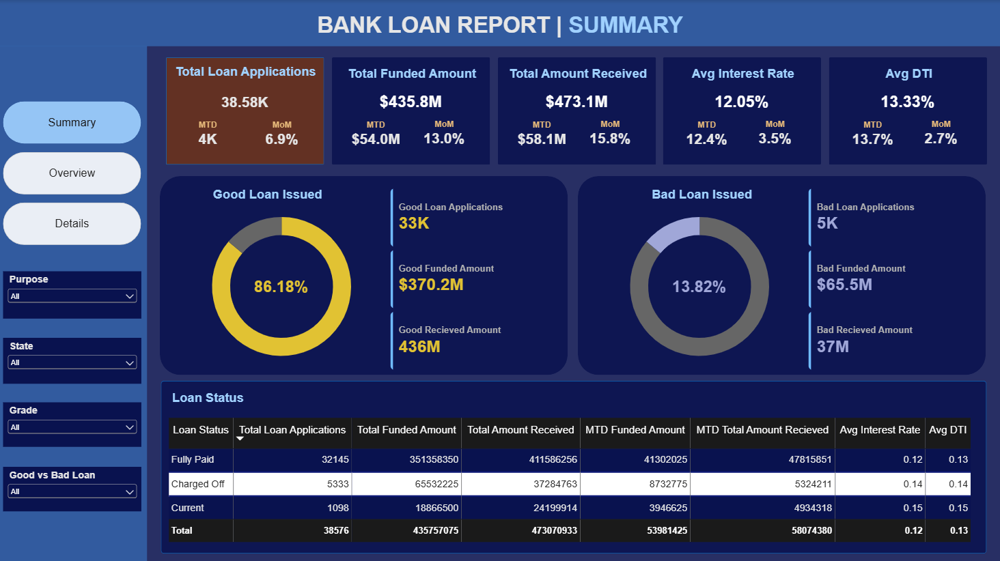

# Bank Loan Analysis

A bank loan analytics project analyzing loan applications, funded amounts, and repayment performance to classify good vs. bad loans, surface approval and repayment factors, and visualize the insights in an interactive Power BI dashboard.

## Overview

This project analyzes a full year of bank loan data — from application through repayment — calculating key KPIs, classifying loans by performance, breaking down trends by time, region, and customer profile, and identifying the factors most linked to approval and repayment outcomes.

- **Total Loan Applications:** 38,576
- **Total Funded Amount:** $435.8M
- **Total Amount Received:** $473.1M
- **Net Gain:** +$37.3M (8.6% return on funded amount)

## Project Structure

```
├── data/
│   └── financial_loan.csv                      # Bank loan dataset
├── docs/
│   ├── report_queries.md                       # All SQL queries
│   └── loan_analysis_report.md                  # Full Analysis Report
├── assets/
│   ├── Bank_Loan_Analysis_Report.pbix           # Power BI file
│   ├── Report_Summary.png                       # Summary dashboard screenshot
│   ├── Report_Overview.png                      # Overview dashboard screenshot
│   └── Report_Details.png                       # Details dashboard screenshot
└── README.md
```

## Analysis Report

The full breakdown — KPIs, good vs. bad loan performance, loan status and repayment analysis, trends by time/region/customer profile, and factors affecting approval and repayment — is in [docs/loan_analysis_report.md](docs/loan_analysis_report.md). The SQL behind every metric is in [docs/report_queries.md](docs/report_queries.md).

**Key findings:**
- 86.18% of loans are classified as "good" (Fully Paid or Current), returning nearly 18% more than was lent out
- Charged-off loans recover only 56.9% of funded money, a loss of roughly $28.2M
- Monthly lending more than doubled over the year, growing from $25M in January to $54M in December
- California, New York, Texas, and Florida account for the bulk of funded loans
- Debt consolidation drives roughly 53% of all funding
- Higher interest rate and higher DTI are the strongest early indicators of default

## Recommendations

Seven recommendations — covering risk screening, monitoring the "Current" loan book, geographic diversification, and product strategy — are detailed at the end of [docs/loan_analysis_report.md](docs/loan_analysis_report.md).

## Dashboard

The Power BI dashboard has three pages — Summary, Overview, and Details — with filters for Purpose, State, Grade, and Good vs. Bad Loan status.



**Summary** — total applications, funded amount, amount received, average interest rate and DTI, plus a good vs. bad loan breakdown with month-to-date comparisons.

The Overview (funded amount trends by month, state, term, employee length, purpose, and home ownership) and Details (loan-level record table) pages are included as screenshots in the `assets/` folder, alongside the full interactive `.pbix` file (`assets/Bank_Loan_Analysis_Report.pbix`, requires Power BI Desktop to open).

## Tools Used

- **SQL** — KPI calculation and trend analysis
- **Power BI** — Visualization